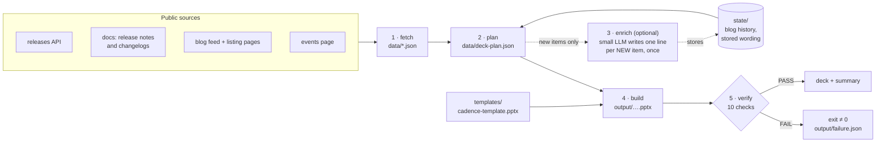

# auto-pptx — the weekly HashiCorp product-updates deck

Every week this builds a **fresh PowerPoint deck of the slides that can be automated** — Terraform and
Vault releases, HCP changelogs, recent blogs, upcoming webinars and events — straight from public
HashiCorp sources, in the cadence deck's own fonts, colours and layout. Drop its slides into a customer
deck, or present it as it is.

> **Built, not patched.** Each run starts from a slim template and writes every slide from the data of
> that day. Nothing depends on last week's deck, so a run is reproducible, a missed week costs nothing,
> and there is no customer deck in the loop at all.

```bash
make build        # ~30 seconds: fetch -> plan -> build -> verify
open output/hashicorp-product-updates-<date>.pptx
```

---

## What is in the deck

| Slide | Content | Source |
|-------|---------|--------|
| Cover | Month, build date, "review before sharing" status | — |
| Terraform Core/CLI – GitHub Releases | Every release of the last three months, pre-releases included | [releases API] + Terraform `CHANGELOG.md` |
| Terraform Enterprise Upgrades | Every TFE release, one line each | [TFE releases] |
| HCP Terraform Upgrades | The dated changelog entries | [HCP Terraform changelog] |
| Terraform Recent Blogs | The 8 newest Terraform posts | [blog] feed + Terraform listing page |
| Terraform Upcoming Webinars | The 3 soonest Terraform webinars / workshops | [events page] |
| Vault Enterprise Release Updates | Vault 2.x and the Enterprise LTS patches, grouped per release day | [releases API] + [Vault release notes] |
| HCP Vault Release Updates | The dated changelog entries | [HCP Vault changelog] |
| Vault Recent Blogs | The 8 newest Vault posts | [blog] feed + Vault listing page |
| Vault Upcoming Webinars | The 3 soonest Vault webinars / workshops | [events page] |
| Featured event (one slide each) | In-person events: public ones and the ones in `config/featured-events.yaml` | [events page] + that file |

A slide with nothing to show (no upcoming event, say) is **left out** — never shipped empty or stale.
The summary printed at the end of a build says what was left out and why.

## Quick start

```bash
git clone <this-repo-url> auto-pptx && cd auto-pptx
python3 -m venv .venv && source .venv/bin/activate
pip install -r requirements.txt
python -m playwright install chromium     # the events and blog-listing pages need a real browser
make build
```

The deck lands in `output/`, with a summary like this:

```text
| # | Slide | Content |
| 2 | terraform-core-releases | August: 7; September: 7; October: 1 — newest: v1.17.0-rc1 (2026-10-07) |
| 7 | vault-enterprise-releases | August: 1; September: 2; October: 1 — newest: v2.1.2 / v1.21.12 / … |
...
=== OVERALL: PASS ===
```

Open it and read it before it goes to a customer: the cover says so too.

| Command | What it does |
|---------|--------------|
| `make build` | The whole thing: fetch → plan → enrich → build → verify |
| `make deck` | Rebuild and verify from the data already fetched (no network, no model) |
| `make fetch` / `make plan` / `make verify` / `make summary` | One step at a time |
| `make test` | The offline test suite (~15 s) |
| `make template DECK="…pptx"` | Re-cut the template from a new reference deck |
| `make preflight` | What this machine can reach, which settings are present |
| `EVENT_SCOPE=GLOBAL make build` | In-person events from every region (default: EMEA + MENA; online sessions are never filtered) |

---

## How it works



1. **Fetch** (`scripts/fetch_*.py`) — plain HTTP and one headless browser. Each release slide needs
   three months of history, so the fetchers page back through it rather than keep it from an old deck.
2. **Plan** (`scripts/plan_deck.py`) — turns the data into exactly what every slide will say. One
   JSON file; a pure function of the data, the stored wording and the config.
3. **Enrich** (`scripts/enrich.py`, optional) — for an item nobody has worded yet, a small model
   writes one line from the public release notes. It is stored in `state/enrichment.json` and reused
   from then on, so the deck is not reworded every week and a person can correct a line by editing
   that file. Without a model the plan falls back to fixed rules.
4. **Build** (`scripts/build_deck.py`) — clones the template's own paragraphs to write each slide, and
   **measures the text** so a column or card is filled to what fits instead of running out of its box.
5. **Verify** (`scripts/verify_build.py`) — reads the finished deck back and checks it (below).

Steps 1, 2, 4 and 5 involve no model: the same data gives the same deck, byte for byte on the slides.

### Slides are found by role, not by number

The old approach mapped "slide 9 = blogs" and broke whenever the deck gained a slide. Now
`make template` finds each slide in a reference deck **by its title text** (`config/deck.yaml`) and
stamps it with a role; everything downstream looks slides up by that stamp. When the cadence deck's
design changes, re-cut the template from the new deck — no slide number appears anywhere.

```bash
make template DECK="~/Downloads/CSE EMEA Customer Cadence Deck OCTOBER 2026.pptx"
```

Cutting the template also carries the deck's hand-written wording over into `state/`, so highlights a
person already wrote are reused rather than regenerated.

### The rules each slide follows

These mirror how the reference deck is maintained by hand.

- **Month columns** show the three most recent months that *have* entries (Vault can skip a month),
  oldest on the left, newest entry first within a month.
- **Terraform Core** lists every GitHub release, alpha / beta / rc included, each described by its
  category — `Bug fixes`, `Pre-release`, `New features, enhancements and bug fixes`. Release dates come
  from the changelog heading, which is what the release page shows.
- **Vault** versions released on the same day share one entry — `v2.1.2 / v1.21.12 / v1.20.17 /
  v1.19.23 (2026-10-07)` — each version linked to its own release notes.
- **Wording**: stored wording first (a person's, or the enrichment step's); otherwise what the release
  *adds*, as one sentence; a release that only fixes things gets its category label.
- **Blogs**: a post belongs to a product when its *title* names it; a title naming another product
  never does. The 8 newest are shown; `state/blogs.json` remembers posts the live sources no longer
  reach back to.
- **Event cards** show webinars and workshops badged for the product, soonest first, each with its type,
  product icon(s) and language flag. A session badged for both products appears on both slides. The
  dated events come from the events page's own search index (the data the page renders its cards
  from), so they do not depend on getting a browser past hashicorp.com's bot check; the page itself
  is rendered for the abstracts and its undated promotions (see docs/pipelines.md).
  Webinars and workshops are **online**: they are never filtered by region (the events page tags them
  with the audience's time zone, not a venue). Only **in-person** events — the Featured / In Person
  section — are held to the region scope. Anything the page promotes **without a date** (its
  "Featured Events" box, a city series' "Coming soon" sessions) is listed in the weekly summary, split
  into online and in-person, so a date can be added in `config/featured-events.yaml`.
- **Layout** (`scripts/lib/layout.py`): the template inherits the hand-made deck's small drifts, so
  every build re-aligns what repeats — event cards on one line, each flag in the same corner, product
  icons on one top line 13.5 pt apart, month headers level, the blog grid square, a gap between two
  highlights of the same release — and crops any picture that runs past the slide's edge.
- **Text fitting**: if a month does not fit at the template's spacing, the slide tightens its spacing
  before it shortens any wording, and only as a last resort trims the oldest entries (and says so).

### What the gate checks

`verify_build.py` trusts neither the builder nor its report. It re-reads the `.pptx` and checks:

| Check | Fails when |
|-------|-----------|
| `package` | the deck does not open, a slide is hidden, or the slides are not the planned ones in order |
| `columns` | a column's entries, links or wording differ from the plan — or the newest release **in the data** is not on the slide |
| `blogs` | a post is missing, mislinked, out of order or shown twice |
| `events` | a card differs from the plan, lacks a description, or its event is already in the past |
| `fit` | any column, card or title is predicted to overflow its box (measured again from the deck) |
| `layout` | anything extends past the slide, or a card, flag, icon, month header or blog entry is off its line, or two highlights run together |
| `links` | a link is dangling, not http(s), or points at an internal host (w3, GitHub Enterprise, Box, Slack …) |
| `disclosure` | the deck names a CVE that the fetched public release notes do not |
| `formatting` | a slide uses a colour or typeface the template does not, or the deck embeds a font under another font's name |
| `freshness` | the cover shows the wrong month or claims the deck is ready to publish |

Every one of these has a test that hands the gate a deliberately damaged deck (`tests/test_build.py`).

---

## Running it every week

Two pipelines run the build unattended — on GitHub Actions in this repository
(`.github/workflows/`), or on IBM Secure Pipelines Service; [`docs/pipelines.md`](docs/pipelines.md)
covers both:

- **Weekly build** — on a schedule: build, verify, publish the deck as a GitHub release
  (`…/releases/latest` always opens this week's deck).
- **Self-heal** — only when the weekly build fails: a larger model repairs the code, the pipeline
  proves the repair with the tests and a full rebuild, and proposes it as a pull request.

Credentials live in the pipeline's secret store, never in this repository.

## Changing what the deck says

| I want to… | Do this |
|------------|---------|
| add an in-person event that is not on the public events page | add it to `config/featured-events.yaml` |
| correct or rewrite a highlight | edit its entry in `state/enrichment.json` (or delete it to have it regenerated) — on the `pipeline-state` branch, which the builds on GitHub read it from |
| show Terraform releases as sentences instead of labels | remove `wording: label` in `config/deck.yaml` |
| change the region scope for events | `events.scope_regions` in `config/sources.yaml`, or `EVENT_SCOPE` for one run |
| follow a redesigned cadence deck | `make template DECK="new deck.pptx"` |
| automate another slide | add a role to `config/deck.yaml`, re-cut the template, teach `plan_deck.py` what goes on it |

## Public sources only

The deck goes to customers, so everything on it must already be public. The fetchers read only public
HashiCorp and IBM pages (`config/sources.yaml`), and three things enforce the rest:

- the enrichment model is given nothing but that public text, and a line it writes is accepted only if
  every version number, figure and CVE id in it occurs in the source it was given;
- a CVE id reaches a slide only if the public release notes for that same release name it — in line
  with IBM's PSIRT disclosure policy, the deck never says more about a vulnerability than the published
  notes do;
- the gate rejects any link to an internal host.

## Repository map

```text
build.sh                 the weekly build (fetch -> plan -> enrich -> build -> verify -> summary)
config/deck.yaml         the deck: its slides (roles), how each is recognised, what fills it
config/sources.yaml      the public sources
config/featured-events.yaml   hand-maintained in-person events
templates/               the slim template the deck is built from (cut by make_template.py)
state/                   blog history + stored wording (small, git-tracked; the pipeline keeps its own on pipeline-state)
scripts/fetch_*.py       fetchers           scripts/plan_deck.py   planner
scripts/build_deck.py    builder            scripts/verify_build.py  gate
scripts/enrich.py        optional LLM wording, cached in state/
scripts/lib/             slide structure finders, text fitting, paragraph composition, …
ci/  .opencode/          the two pipelines and their agents
.github/workflows/       the pipelines on GitHub Actions (.pipeline-config*.yaml: on IBM SPS)
tests/                   offline suite: parsers, planner, text fitting, guards, end-to-end + damaged decks
```

`data/` and `output/` are generated and git-ignored.

## Legacy: updating a full customer deck in place

`run.sh` and the `edit_*_slides.py` / `verify_deck.py` scripts are the earlier approach: copy a full
customer deck and patch its automated slides by number, with GitHub Copilot CLI agents fixing what the
scripts could not. They are still here but are **not maintained for the current deck layout** (the
October 2026 deck moved those slides) and are not what the pipelines run. Use the weekly build and copy
its slides into the customer deck instead.

## Licensing notes

- The vendored `pptx` skill under `.github/skills/pptx/` is **proprietary to Anthropic** — see its
  `LICENSE.txt` before redistribution.
- `assets/fonts/` holds Inter (SIL Open Font License) for text measurement only; see its `CREDITS.md`.

[releases API]: https://api.releases.hashicorp.com/v1/releases/terraform
[TFE releases]: https://developer.hashicorp.com/terraform/enterprise/releases
[HCP Terraform changelog]: https://developer.hashicorp.com/terraform/cloud-docs/changelog
[Vault release notes]: https://developer.hashicorp.com/vault/docs/updates/release-notes
[HCP Vault changelog]: https://developer.hashicorp.com/hcp/docs/vault/changelog
[blog]: https://www.hashicorp.com/blog
[events page]: https://www.hashicorp.com/en/events
