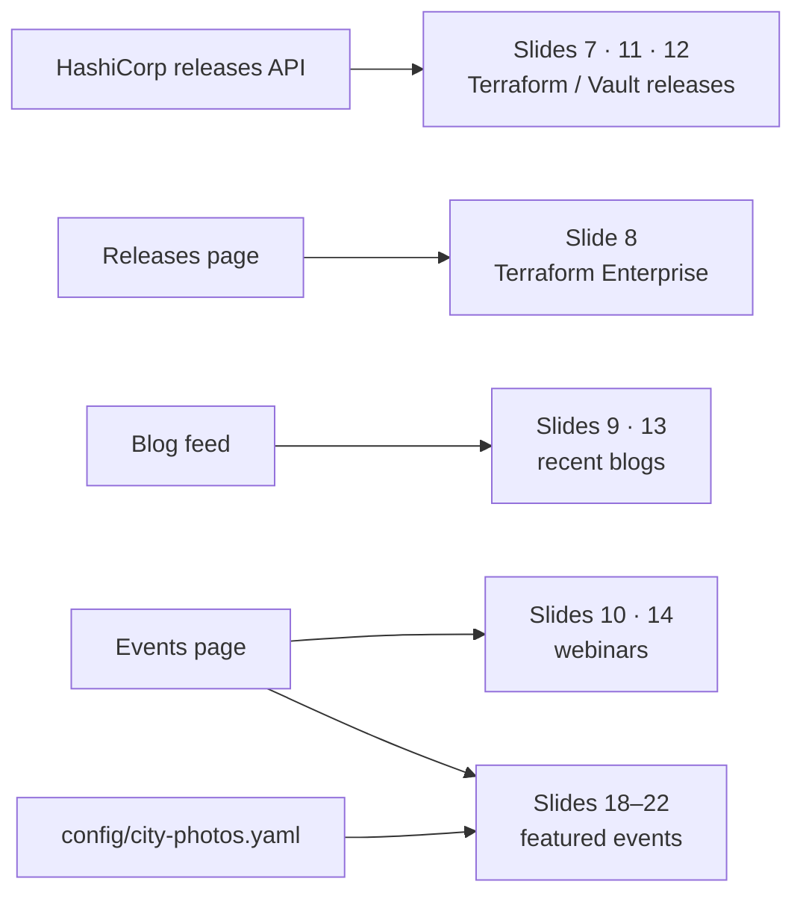
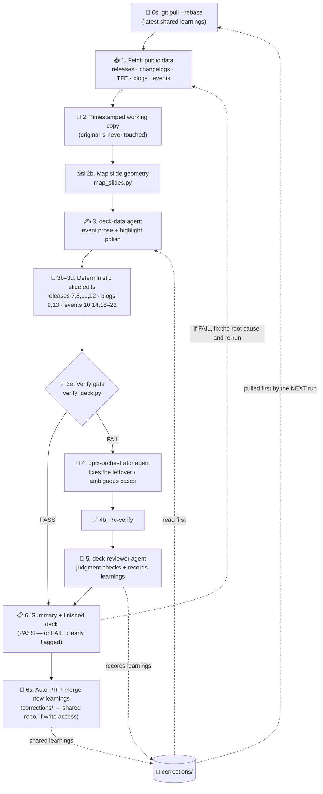

# auto-pptx — Automated HashiCorp Cadence Deck Updater

Keep the recurring **CSE EMEA Customer Cadence Deck** up to date **without hand-editing slides
every month**. You point this tool at your PowerPoint, it gathers the latest public HashiCorp
information (product releases, blog posts, webinars and events), and it writes you a **new copy of
the deck** with those slides refreshed — in the deck's own fonts, colours and layout.

It's powered by the **GitHub Copilot CLI** with a few purpose-built "skills" and "agents", plus some
plain Python for the boring, predictable bits.

> 🔒 **Your original file is never touched.** Every run saves a brand-new, timestamped copy in the
> `output/` folder. Slides that have no fresh information are **hidden, not deleted** — so nothing is
> ever lost.

---

## Quick start

**One-time setup** — clone, install deps, the headless browser used for the events page, and sign in to Copilot:
```bash
git clone <this-repo-url> auto-pptx && cd auto-pptx
python3 -m venv .venv && source .venv/bin/activate
pip install -r requirements.txt
python -m playwright install chromium          # used to fetch the events page
copilot                                         # sign in once (or set COPILOT_GITHUB_TOKEN — see .env.example)
```
Then drop your deck — any single `.pptx` — in the project root. Now pick how to run it:

### ① Let Copilot run it (easiest)
A fresh `copilot` session in this repo **auto-loads** the scope guardrails
(`.github/copilot-instructions.md`) and the three custom agents, so you can just *ask*:
```bash
source .venv/bin/activate && copilot
```
```text
/allow-all     # let it run the pipeline's shell + file edits without prompting
> Run the full cadence deck pipeline in the background (bash run.sh) and tell me when it's done, with the summary.
```
It launches the run in the **background** (logging to `output/run-*.log`), keeps the window
responsive, and prints the change-summary when it finishes. Live progress? `tail -f output/run-*.log`
in another terminal.

**Want only certain regions?** Events and webinars are region-scoped — just say so and Copilot sets
`EVENT_SCOPE` for the run (default is **EMEA + MENA**, since this is the CSE EMEA deck):
```text
> Run the pipeline for EMEA and MENA only, in the background, and show me the summary when it's done.
> Run it for the whole world (global), in the background.
> Run it for the USA only.
```

### ② One command
```bash
make run-local
```

Either way, the finished, **timestamped copy lands in `output/`** (your original is untouched) and the
run ends with a summary table + a *"please review before sharing"* notice. A clean run is
**~5–10 minutes** (a little longer only if the AI build/review agents are needed to fix a gap, or you
set `FORCE_AGENTS=1`). Want it on a schedule? See [Running it unattended](#running-it-unattended-docker--scheduled).

Useful variants:
```bash
make help                              # list every command
make fetch                             # just refresh data/*.json (seconds, no Copilot credits)
make summary                           # re-print the change table for the newest deck in output/
SKIP_DATA=1 SKIP_REVIEW=1 make run-local   # run only part of the pipeline (see run.sh for flags)
SOURCE_PPTX="/path/to/Deck.pptx" make run-local   # use a deck that lives outside the repo
EVENT_SCOPE="EMEA,MENA" make run-local     # scope events/webinars to regions (default: EMEA+MENA)
EVENT_SCOPE=GLOBAL make run-local          #   …everywhere; or EVENT_SCOPE=USA for Americas only
```

> **Region scope:** `EVENT_SCOPE` overrides `config/sources.yaml` `events.scope_regions` for one run.
> Known regions are **EMEA, MENA, APAC, AMERICAS** (handy aliases: `USA`/`US` → AMERICAS, `EU` → EMEA,
> `ASIA` → APAC); `GLOBAL` (or `ALL`) means no filter. Online webinars (no location) are always kept.
> Out-of-scope in-person events/webinars are dropped before they reach the slides.

> **Power user:** run the deterministic phases yourself (`make fetch`), then drive a single agent for a
> one-off edit with `copilot --agent pptx-orchestrator --allow-all -p "…"`. Launch from the repo root with
> `.venv` active so the agents, guardrails, and headless browser are all available.

---

## In plain English: what does it actually do?

Once a month (or whenever you like) you would normally open the deck and manually:
- update the **Terraform / Vault release** slides with the newest versions,
- swap in the **latest blog posts**,
- refresh the **upcoming webinars and events**.

This tool does that for you and hands back a finished copy to review. You stay in control: you open
the result, check it, and tweak anything you don't like. If you correct something, the tool
**remembers** so it does it your way next time.

### What it updates for you

| Slides | What | Where the info comes from |
|--------|------|---------------------------|
| 7, 11, 12 | Terraform / Vault (Enterprise + HCP) **release** updates | HashiCorp releases API |
| 8 | **Terraform Enterprise** releases | HashiCorp releases page |
| 9, 13 | Terraform / Vault recent **blogs** | HashiCorp blog feed |
| 10, 14 | Terraform / Vault upcoming **webinars** | HashiCorp events page |
| 18–22 | Featured / in-person **events** (title, date, 2–3 bullet description, photo) | HashiCorp events page |



Everything else — customer-specific slides, success plans, intro/branding slides — is **left exactly
as you made it**. This tool only touches the slides listed above.

> **Does it always edit the same slides?** Yes — it edits the slide **numbers** declared in
> [`config/slide-map.yaml`](config/slide-map.yaml) (7, 8, 9, …). It does *not* auto-detect "the blogs
> slide" by content. So if you **reorder the deck** (say, recent blogs move from slide 9 to slide 10),
> update those numbers in `config/slide-map.yaml` — that one file is the single source of truth for
> what maps to what. You won't get a *silent* mistake if you forget: the editors are **structure-aware**
> (they look for the actual release columns / blog entries / webinar slots on each slide) and the
> verify gate checks every configured slide, so a number pointing at the wrong slide simply finds
> nothing to edit and is **flagged**, never corrupted.

---

## How you'd typically use it (the monthly routine)

1. **Drop in the latest deck.** Put your current `.pptx` in the project folder (or keep the one
   that's already there).
2. **Run one command.**
   ```bash
   make run-local
   ```
   This usually takes **~5–10 minutes**: the data gathering and slide edits are deterministic Python
   that finishes fast, and the AI agents only run if the deterministic deck doesn't already pass the
   verification gate (a little longer if they do). Either way it's a "kick it off and come back"
   job — see the [fresh Copilot window](#run-it-from-a-fresh-copilot-window-the-friendly-way) tip to
   launch it in the background.
3. **Open the result.** Look in the `output/` folder for the newest file, e.g.
   `CSE EMEA Customer Cadence Deck JUNE 2026 — 2026-06-18-1703.pptx`. Your original is untouched.
   The run ends by printing a **summary table of everything it changed** (which slides, what action)
   plus a clear *"please review before sharing"* notice with the exact path to your new deck — so you
   always know what to double-check. Re-print it anytime with `make summary`.
4. **Review it.** The printed summary, a plain-text report (`output/verify-*.txt`) and a written
   review (`output/review-*.md`) tell you what changed and confirm the style and slide-hiding are
   correct.
5. **Correct anything you don't like — once.** Record the fix so it becomes a permanent rule:
   ```bash
   python scripts/capture_correction.py "Vault webinar descriptions: keep to one line" \
       --category events --slide 14 --source human
   ```
   Next run, the assistant reads your corrections first and follows them. That's the "it learns"
   part.

That's the whole loop: **run → review → (optionally) correct → run again**.

> 💡 Just want the raw data without running the full assistant? `make fetch` refreshes the
> `data/*.json` files (releases, blogs) in a few seconds and uses no Copilot credits.

---

## What you need

- **GitHub Copilot CLI** (and a Copilot subscription). A fine-grained token with the
  **"Copilot Requests"** permission for unattended/Docker runs.
- **Python 3.11+** and the packages in `requirements.txt`.
- *(For the upcoming-events slides)* a one-time Playwright Chromium install (the events page is
  behind a bot-check that only a real browser passes). Without it, events fall back to the agent.
  Featured-event **photos** no longer need a browser: each slide's hero is the event **city photo**,
  resolved at edit time from `config/city-photos.yaml` (a photo bundled in the source deck, or a
  freely-licensed file in `assets/city-photos/`).
- *(Optional, for the visual review step)* LibreOffice + poppler — already included if you use Docker.

First-time setup:
```bash
python -m venv .venv && source .venv/bin/activate
pip install -r requirements.txt
python -m playwright install chromium   # enables the events fetcher
```

---

## Running it unattended (Docker / scheduled)

If you want this to run by itself on a schedule (say, monthly), use the Docker image:
```bash
cp .env.example .env        # add COPILOT_GITHUB_TOKEN (fine-grained PAT, "Copilot Requests")
make build-image
make docker-run             # one self-contained run; writes a new deck to ./output/
```
Each run is one-shot and repeatable (always a fresh timestamped copy), so you can drive
`make docker-run` from cron, launchd, or CI on whatever cadence you want.

You can also run just part of the pipeline:
```bash
SKIP_DATA=1 SKIP_REVIEW=1 bash run.sh      # fetch + copy + build only
FORCE_AGENTS=1 bash run.sh                 # always run the build + review agents (skip the gate shortcut)
```

---

## ⚠️ Before you publish this repository

This project is safe to share, but **the deck itself is internal HashiCorp material**. Before
pushing to GitHub:

- **Don't commit the customer deck** to a public (or broadly shared) repository. See
  "Bring your own deck" below — keep the `.pptx` out of git and have each user drop in their own.
- **Don't commit secrets.** `.env` is already git-ignored; only `.env.example` (no real values) is
  tracked. Double-check before your first push.
- `data/` and `output/` (fetched data and generated decks) are git-ignored too, so you won't leak
  generated copies.

**Going public / sharing the bot.** Once it's a shared repo, the **git auto-sync** keeps everyone's
learnings in step: each run pulls the latest `corrections/` first, and a run that records a new rule
opens (and auto-merges, with write access) a `corrections/` PR so the next run — for every user —
applies it. See [The learning loop](#the-learning-loop-corrections). Contributors with only read
access still benefit from the pull; their own new learnings stay local until a maintainer merges them.

### Bring your own deck
The tool automatically picks up the single `.pptx` in the project root, or you can point at one
explicitly:
```bash
SOURCE_PPTX="/path/to/your/Cadence Deck.pptx" make run-local
```
This lets you keep the actual deck **out of the repository** while still sharing the automation.

---

## How it works under the hood

`run.sh` runs a chain of **fast, deterministic Python** steps and only calls the **AI agents when
they're actually needed**. A verification gate in the middle is the trick that keeps a clean run fast.



**The gate is what makes it fast.** Steps 1–3d are deterministic and free; the **agents** (steps 4–5)
are where the time and Copilot credits go. Because the release, blog and event edits are now plain
Python, the deck usually passes `verify_deck` on its own — so the build and review agents are
**skipped entirely** and the run finishes in ~5–10 min. They only kick in when the gate finds a real
gap (or you set `FORCE_AGENTS=1`).

What the gate checks (`verify_deck.py`): integrity (slide count unchanged), hide-audit (`show="0"`,
never deleted), style (no foreign colour/font), release columns + date-keyed accuracy, blog/event
coverage, no-empty-box, and photo + brand-logo consistency. A single `run.sh` is **best-effort**: it
always writes the deck and prints the summary, and it **can end on a FAIL** — but it never hides one
(the summary shows a clear ⚠️ and points you at the report).

> **So can a run end on a FAIL? Yes — and that's expected.** One `run.sh` is a single, best-effort
> pass with **no automatic loop inside it**: if the build agent (4) can't close the gap, re-verify (4b)
> still fails, the reviewer (5) reports it, and the run ends at the summary (6) with the FAIL flagged
> (the deck is still written, for inspection; exit code is `0`).
>
> **Loop-until-pass is the operator's job, one level up.** Per `.github/copilot-instructions.md`, the
> Copilot agent — and you — must inspect the FAIL, fix the root cause, record the learning, and
> **re-run** until it's green. If a check is genuinely unfixable (a source truly lacks the data), it
> **stops and flags it for you** instead of looping forever or faking a pass. So *asking Copilot to run
> it* self-corrects across runs; a bare `bash run.sh` you launch by hand is just one pass.
>
> The **learning loop** (reviewer → `corrections/` → next run) is separate and report-only — it never
> jumps back to the gate. See [The learning loop](#the-learning-loop-corrections).

### Skills (`.github/skills/`)
- **`pptx/`** — vendored from [anthropics/skills] at a pinned commit (see `.skill-manifest.json`).
  Provides the `unpack → edit → clean → pack` workflow that preserves all PowerPoint formatting.
- **`skill-updater/`** — checks whether the vendored pptx skill drifted from upstream before each
  run (`notify` by default; `update` to auto re-vendor). Keeps runs reproducible.
- **`hashicorp-deck-style/`** — the **mandatory** style guide: brand palette (`palette.json`),
  fonts (Inter/Poppins), per-slide layouts, date formats, tone, and a `style_check.py` guard that
  fails if a foreign colour/font is introduced.

### Agents (`.github/agents/`)
- **`deck-data`** — fills the prose Python can't and lightly polishes the pre-fetched release
  highlights from a local changelog excerpt (no web access). Release highlights and Terraform
  Enterprise releases are now fetched **deterministically** in step 1, so this agent mostly writes
  short event descriptions/locations. Writes only `data/*.json`; never invents facts.
- **`pptx-orchestrator`** — edits only the slides in `config/slide-map.yaml`, replacing text inside
  existing runs (never touching formatting), updating link targets, and hiding empty slides.
- **`deck-reviewer`** — verifies style preservation, data accuracy, links, featured-event photo
  consistency, and hide-don't-delete; writes `output/review-<stamp>.md` and records durable rules into
  the corrections log.

### Guardrails (`.github/copilot-instructions.md`)
Every Copilot session in this repo (the CLI window, the coding agent, or the pipeline's own
sub-agents) reads this file first. It pins the scope so the assistant **only** edits the automatable
slides, never touches the source deck, hides-rather-than-deletes, preserves the deck's style, and
never fabricates data. If you drive the deck interactively in the Copilot window instead of via
`run.sh` (see [Run it from a fresh Copilot window](#run-it-from-a-fresh-copilot-window-the-friendly-way)),
these are the rules it follows.

### The learning loop (`corrections/`)
The orchestrator **reads `corrections/corrections.md` before every run** and applies each rule. The
reviewer also records recurring issues automatically. Newer rules override older ones — so the tool
gets more "you" over time.

**Shared learnings (git auto-sync).** When the repo is shared, those learnings are kept in sync for
everyone, automatically, around each run:

- **Before a run** (`GIT_SYNC=1`, default) it does a `git pull --rebase --autostash` so you start from
  the latest learnings other people merged.
- **After a run** (`AUTO_PR=1`, default) — *if* this run recorded a new rule under `corrections/` — it
  opens a small PR with just that change and **auto-merges it** (`AUTO_MERGE=1`) when **you have write
  access** and `gh` is authenticated for the remote's host. Then everyone's *next* run picks it up via
  the pre-run pull.

It's entirely **best-effort and non-fatal**: with no remote, no `gh` auth, or read-only access, the
learning is simply kept in your working tree (the run still succeeds) and the tool tells you to push it
manually or have a maintainer merge it. Nothing is ever force-pushed, and only `corrections/` is shared
(your deck, `data/`, and `output/` are git-ignored and never leave your machine). Turn any of it off
with `GIT_SYNC=0` / `AUTO_PR=0` / `AUTO_MERGE=0` (see `.env.example`).

---

## Configuration
- `config/sources.yaml` — source URLs, product keywords, item counts, retry policy, and the default
  event/webinar **region scope** (`events.scope_regions`).
- `config/slide-map.yaml` — which slide maps to which data, plus slot hints. **This is the one place**
  to add or adjust which slides get automated (the slide numbers above live here).
- `config/city-photos.yaml` — the featured-event hero **city photos** (a photo bundled in the source
  deck, or a freely-licensed file under `assets/city-photos/`). Add a city here and every featured slot
  for that city picks it up automatically.

### Region filters (`EVENT_SCOPE`)
Events and webinars are filtered to the regions you care about. The default is **EMEA + MENA** (this is
the CSE EMEA deck); set `events.scope_regions` in `config/sources.yaml` to change the default, or
`EVENT_SCOPE` to override it for a single run. Online webinars (no location) are always kept; in-person
events outside the scope are dropped before they reach the slides.

| `EVENT_SCOPE` | Keeps | Notes |
|---|---|---|
| `GLOBAL` (or `ALL`) | Everywhere | No region filter |
| `EMEA` | Europe + Middle East + Africa | **Includes MENA** (MENA is a subset of EMEA) |
| `MENA` | Middle East + North Africa only | The subset on its own (excludes the rest of Europe/Africa) |
| `APAC` | Asia-Pacific | incl. ANZ, India, Japan |
| `AMERICAS` | North + Latin America | |
| `EMEA,MENA` | Same as `EMEA` | The default for this deck |

Handy aliases (case-insensitive): `USA`/`US` → AMERICAS, `EU`/`EUROPE` → EMEA, `ASIA` → APAC,
`"Middle East"` → MENA. Combine regions with commas, e.g. `EVENT_SCOPE="EMEA,APAC"`. Unknown words are
kept (never silently dropped) so a brand-new region keyword still works once it's added to
`scripts/lib/regions.py`.

```bash
EVENT_SCOPE="EMEA,MENA" make run-local   # default — Europe, Middle East, Africa
EVENT_SCOPE=GLOBAL      make run-local   # everywhere
EVENT_SCOPE=USA         make run-local   # Americas only
```

## Roadmap / not yet wired
- **Today's primary workflow is the interactive, manual run with Copilot** ([Quick start ①](#-let-copilot-run-it-easiest)):
  kick it off, review the result, correct anything once. The
  [Docker path](#running-it-unattended-docker--scheduled) already covers scheduled batch runs.
- **Delivery to OneDrive / Box** (not Google Drive): auto-upload the finished deck to a shared folder
  after the review phase. Placeholders live in `.env.example`; the upload step plugs in there.
- **Serverless scheduling**: run the container as a scheduled cloud job (a function / job runner)
  instead of a host with cron, for a hands-off monthly refresh.

## Licensing note
The vendored `pptx` skill is **proprietary to Anthropic** — see `.github/skills/pptx/LICENSE.txt`.
Review its terms before redistribution.

[anthropics/skills]: https://github.com/anthropics/skills
