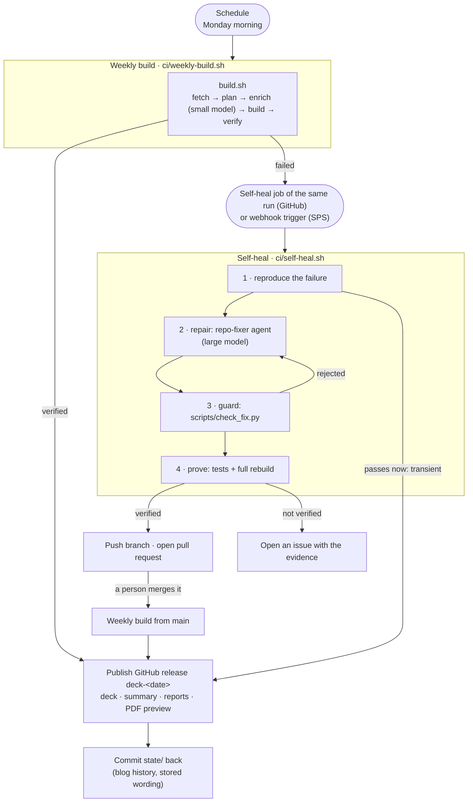

# Pipelines: the weekly build and the self-heal run

Two pipelines run this repository: the weekly build and the self-heal run. They run on GitHub
Actions in this repository ([below](#on-github-actions)) and are also set up for IBM Secure Pipelines
Service (SPS). Both hosts are thin: everything the pipelines do is in `ci/` and `build.sh`, so the
same commands run on a laptop.



| | Weekly build | Self-heal |
|---|---|---|
| Starts | on a schedule, once a week | when a weekly run fails (or by hand) |
| Model | small — `enrich-model`, default `ica-gateway/claude-haiku-5-5`; when it gives no answer, `enrich-fallback-model`, default `ica-gateway/gpt-6-luna` | large — `fix-model`, default `ica-gateway/claude-sonnet-5-5`; when it gives no answer, `fix-fallback-model`, default `ica-gateway/gpt-6.1-sol` |
| The model's job | word *new* release notes and event abstracts, one line each | find and fix the code that made the build fail |
| What the model can touch | nothing: it is called directly, text in and JSON out (on a laptop without the gateway key, the `deck-enrich` opencode agent: one JSON file in a scratch directory, no shell, no network) | a copy of the checkout, with a shell — on GitHub as another user that holds no secret ([the sandbox](#the-sandbox)); never the checkout the pipeline runs from |
| Result | a GitHub release with the deck | a pull request with the fix, whose merge publishes the week's deck — or an issue |

---

## On GitHub Actions

This repository runs both pipelines on GitHub Actions:

| File | What it is |
|------|------------|
| `.github/workflows/weekly-deck.yml` | the weekly build: Mondays 05:17 UTC (06:17 in Madrid in winter, 07:17 in summer), or **Run workflow** with `mode` = `weekly` or `preflight`, optionally as a dry run |
| `.github/workflows/self-heal.yml` | the self-heal run: a job of a failed weekly run, or **Run workflow** by hand |
| `.github/workflows/pr-review.yml` | the [pull request review](#the-pull-request-review): a model's verdict on each pull request, as one comment |
| `.github/actions/setup/` | what the Dockerfile puts in the SPS image, installed on the runner: Python and the requirements, Chromium, LibreOffice, Inter, and the opencode version the `Dockerfile` pins (only the self-heal run installs opencode: the weekly build calls its model directly) |

What differs from SPS:

- **No image to build.** The runner installs the tools at the start of each run; pip packages and
  Chromium are cached between runs.
- **No personal token.** Publishing, the state commit, the repair branch, the pull request and the
  issue use the job's own `GITHUB_TOKEN`: this repository only, only the permissions the job
  declares, and only while the job runs.
- **No webhook.** A build failure that a code change could repair writes `self-heal=true` to the
  step's output (`ci_trigger_selfheal` in `ci/lib.sh`), and the weekly workflow's `self-heal` job
  then runs `self-heal.yml` in the same run. A publishing failure (exit 60) and a dry run start
  nothing.
- **The schedule is in UTC**, so the local time moves with daylight saving.
- **Actions from other repositories are pinned to a commit**, with the release in a comment (the
  hashicorp org checks this: `GHA_Pinned_Hashes_Check`). To update one, pin the new release's commit.
- **Each run also keeps its `output/`** (the deck, the summary, the logs; for self-heal also the
  agent's logs and the guard's verdict) as a run artifact for 30 days.

Settings, under **Settings → Secrets and variables → Actions**:

| Name | Kind | Value |
|------|------|-------|
| `ICA_API_KEY` | secret | the LLM gateway key. Without it the deck is built with the rule-based wording, and self-heal can still recover from a transient failure but cannot repair one: it opens an issue. |
| `ICA_BASE_URL` | variable | the gateway's OpenAI-compatible base URL, ending in `/v1` |
| `KEY_ENVIRONMENT` | variable, optional | the name of an environment (**Settings → Environments**) that holds `ICA_API_KEY` and `BOB_API_KEY` instead of the repository, with **Deployment branches** limited to `main`. Runs from `main` then get the key and runs from any other branch do not, so a workflow changed on a branch, which needs no review, cannot reach it. In hashicorp/agentic-clm: `gateway`. Unset: the repository secret is used. |
| `BOB_API_KEY` | secret, optional | an IBM Bob API key: the [last resort](#when-the-ica-gateway-is-down-ibm-bob) of every model step (the wording, the review, the repair agent) when the ICA gateway gives no answer. Unset: no Bob. |
| `BOB_FALLBACK`, `BOB_MAX_COST`, `BOB_MAX_COST_AGENT` | variables, optional | `0` leaves Bob out even with its key; the most one Bob question may cost (USD, default 1) and one Bob repair (default 5) |
| `REVIEW_MODELS` | variable, optional | the review's models, in order of preference; unset means `ica-gateway/gpt-6.1-sol`, then `ica-gateway/claude-sonnet-5-5` (then Bob, the last resort) |
| `REVIEW_MENTION` | variable, optional | GitHub logins copied on every review, space-separated (in hashicorp/agentic-clm: `nikitastetskiy-hashi`) |
| `ENRICH_MODEL`, `ENRICH_FALLBACK_MODEL`, `FIX_MODEL`, `FIX_FALLBACK_MODEL`, `EVENT_SCOPE`, `STRICT`, `RELEASE_KEEP`, `FIX_ATTEMPTS`, `FIX_TIMEOUT`, `ENRICH` | variables, optional | the settings described for SPS below; unset means the default (Haiku 5.5 for wording, then GPT-6 Luna; Sonnet 5.5 for repairs, then GPT-6.1 Sol) |
| `BASE_BRANCH` | variable, optional | what a repair is proposed against; unset means the branch the run was started on |
| `STATE_BRANCH` | variable, optional | the branch that keeps `state/` between runs; unset means `pipeline-state`. It holds `state/` and nothing else, so the base branch can accept reviewed pull requests only (as `main` does in the hashicorp org). Set it to the base branch's name to commit `state/` there instead. |

In the hashicorp org, `main` only takes pull requests that someone else approved; `.github/CODEOWNERS`
asks `team-clm` for that review, and with **Allow auto-merge** on, `gh pr merge --auto --merge` merges
a pull request as soon as it is approved. The weekly run needs no pull request (see step 2 below).

The self-heal pull request also needs **Settings → Actions → General → Workflow permissions →
Allow GitHub Actions to create and approve pull requests**. GitHub grants "create" and "approve"
with that one switch; nothing in these workflows approves or merges a pull request.

**After rotating the gateway key**, put the new one in `ICA_API_KEY` without it touching a command
line (`gh secret set ICA_API_KEY` reads it from standard input), then check it from GitHub's side:
`gh workflow run weekly-deck.yml -f mode=preflight`. The preflight asks the gateway, one token per
model, whether it accepts the key for the wording and the repair model (`scripts/lib/gateway.py`),
and the run fails when either is refused or unanswered. A weekly run passes with a dead key as long
as nothing needs new wording, so every weekly and self-heal run makes the same check at its start —
there it only reports, with a warning on the run's page.

Cost: GitHub Free includes 2,000 Actions minutes a month for private repositories, and 500 MB of
artifact storage shared with Packages, which is why run artifacts are kept 30 days only.

---

## What SPS is, and which part of it this uses

SPS is IBM's managed DevSecOps service: toolchains on IBM Cloud Continuous Delivery running Tekton
pipelines, with the DevSecOps reference pipelines, Secrets Manager for credentials and an evidence
locker for compliance ([beginner's guide][sps-guide]). Its standard PR and CI pipelines are built to
ship an application: they scan, sign, deploy and collect evidence at every stage.

A weekly document build is not an application release, and the DevSecOps reference pipelines have a
listener for exactly this case — the **Simple Automation Pipeline** (`simple-listener`): "simple
automation scenarios such as running smoke tests, regression suites, or one-off scripts without
triggering unnecessary devsecops tasks like evidence, inventory, issue processing"
([docs][simple-pipeline]). It runs one `execute` stage from a `.pipeline-config.yaml`, and supports
manual, Git, **timed** and **generic webhook** triggers — everything both pipelines need.

- `.pipeline-config.yaml` — `version: '1'`, for the v10 pipeline definitions.
- `.pipeline-config.v11.yaml` — `version: '2'`, for v11. Same job.

### To confirm with the SPS team before the first run

The public documentation covers IBM Cloud DevSecOps; what SPS adds or restricts on top is documented
internally. These points decide whether the setup below works as written:

1. **Is `simple-listener` available** in your SPS toolchain, and in which pipeline version (it needs
   v10.48+, v11.16+ or v9.65+)? That decides which of the two config files to use.
2. **Can the workers reach** `github.ibm.com` (publish, push), the LLM gateway, and the public
   HashiCorp sites? IBM-managed workers run on the public cloud; a Git server that is not on the public
   internet needs a private worker. `pipeline-mode = preflight` answers this from inside a run.
3. **Which registry** may hold the pipeline image, and how do workers authenticate to it?
4. **May a pipeline push** to the repository it builds (the state commit and the repair branch), or
   does branch protection require the state commit to go through a pull request? (Then set
   `state-branch`.)
5. **Timed and generic-webhook triggers** — allowed as they are, or subject to an SPS policy?

---

## One-time setup

### 1. Build and push the image

```bash
docker build -t <registry>/<namespace>/auto-pptx:1 .
docker push <registry>/<namespace>/auto-pptx:1
```

Put that image name in `.pipeline-config.yaml` (and the v11 file), replacing
`icr.io/REPLACE-WITH-YOUR-NAMESPACE/auto-pptx:1`. Rebuild it when `requirements.txt` or the
`Dockerfile` changes — the code itself comes from the pipeline's checkout, not from the image.

### 2. Add the pipeline to the toolchain

In the toolchain's Delivery Pipeline (Tekton), with the DevSecOps pipeline definitions as the
definition source, set these **environment properties**:

| Property | Type | Value |
|----------|------|-------|
| `pipeline-config-repo` | text | this repository's URL |
| `pipeline-config` | text | `.pipeline-config.yaml` (or `.pipeline-config.v11.yaml`) |
| `git-token` | **secure** | a GitHub Enterprise token for this repository — see [credentials](#credentials) |
| `ibmcloud-api-key` | **secure** | required by the pipeline definitions |
| `ica-base-url` | text | the LLM gateway's OpenAI-compatible base URL (ends in `/v1`) |
| `ica-api-key` | **secure** | the gateway API key |
| `enrich-model` | text | `ica-gateway/claude-haiku-5-5` |
| `fix-model` | text | `ica-gateway/claude-sonnet-5-5` |
| `enrich-fallback-model` | text | `ica-gateway/gpt-6-luna` |
| `fix-fallback-model` | text | `ica-gateway/gpt-6.1-sol` |
| `selfheal-webhook-url` | **secure** | the self-heal trigger's webhook URL (step 3) |
| `selfheal-webhook-token` | **secure** | the secret of that trigger |

Optional: `event-scope` (e.g. `EMEA,MENA`), `strict` (`1` = fail when the events page was unreachable),
`release-keep` (prune all but the newest N deck releases), `fix-attempts` (default 2),
`fix-timeout` (seconds, default 2700), `base-branch` (default `main`), `state-branch` (unset = the base
branch; see step 2), `enrich` (`0` = no model in the weekly build), `review-models` (checked by the
preflight; the [pull request review](#the-pull-request-review) itself runs on GitHub Actions).

Secure values belong in Secrets Manager, referenced from the property rather than typed into it:
`{vault::<integration-name>.<secret-group>.<secret-name>}`. The stage reads them with `get_secret`.

### 3. Add the triggers

All three use the EventListener **`simple-listener`**.

| Trigger | Type | Settings | Trigger property |
|---------|------|----------|------------------|
| `weekly-build` | Timed | cron `0 6 * * 1`, your timezone (e.g. `Europe/Madrid`) | `pipeline-mode = weekly` |
| `self-heal` | Generic webhook | securing: *Token matches*, token source: *Header*, key name: `token`, secret: a long random value | `pipeline-mode = self-heal` |
| `manual` | Manual | — | set `pipeline-mode` when you run it |

Copy the `self-heal` trigger's webhook URL and secret into `selfheal-webhook-url` and
`selfheal-webhook-token`. A failed weekly run posts to that URL; that is the only link between the
two pipelines.

A stricter split is to give self-heal its own Delivery Pipeline integration, with its own properties.
Then the weekly pipeline does not hold `fix-model` at all and the two can have different secrets and
worker pools. The scripts are the same either way.

### 4. First run

Run the `manual` trigger with `pipeline-mode = preflight`. It prints which tools the image has, which
hosts the worker can reach and which settings are present (values are never printed), and changes
nothing. Then run it with `pipeline-mode = weekly`.

---

## The weekly build

`ci/weekly-build.sh`:

1. `bash build.sh` — see the README for the steps. The enrichment step uses `enrich-model` and only
   for items that have no stored wording yet; most weeks that is a handful of lines. When that model
   gives no answer at all (refused, unreachable, out of time), `enrich-fallback-model` — another
   vendor's — words them instead; when neither does, those items keep the rule-based wording this
   week and are asked for again next week. An answer the wording rules reject is not a reason to
   switch models.
2. **Verified** → publish and keep state:
   - GitHub release **`deck-<YYYY-MM-DD>`**, with the build summary as its notes and these assets:
     the `.pptx`, `summary-<date>.md`, `build-report.json`, `verify-report.json`, and a PDF preview
     when the image has LibreOffice. `<repo>/releases/latest` therefore always opens this week's deck.
     Re-running a build for the same date updates that release in place.
   - `state/` is committed and pushed, so next week starts from the blog history and the wording this
     run stored: to the base branch, or, with `state-branch` set (on GitHub: `pipeline-state` unless
     the `STATE_BRANCH` variable says otherwise), as a commit holding `state/` alone on that branch,
     which every build reads `state/` from (until the first build creates it, from the checkout).
     Self-heal starts from it too. If the push is refused the build still succeeds and says so.
3. **Failed** → nothing is published (last week's release stays "latest"), the self-heal webhook is
   called, and the run fails.

Releases are used instead of committing the deck because it is a 7 MB binary: committed weekly it
would bloat every clone, while release assets sit outside the git history and can be pruned.

| Exit | Meaning |
|------|---------|
| 0 | deck built, verified, published |
| 10 / 20 / 30 / 40 | a required fetch / the plan / the build / the gate failed (`output/failure.json` has the step and log tail) |
| 50 | degraded and `strict = 1`: the events page was unreachable |
| 60 | deck verified but publishing failed (a credentials or network problem, not a code one) |

## The self-heal run

`ci/self-heal.sh`, on a clean checkout:

1. **Reproduce.** Run the build again. If it passes, the failure was transient: publish the deck and
   stop. No model is involved.
2. **Repair.** The `repo-fixer` agent (`.opencode/agents/repo-fixer.md`) runs on `fix-model`, or on
   `fix-fallback-model` when the first gives no answer at all: the agent ends without writing
   `output/fix-summary.md`, whatever opencode's exit code (opencode can exit 0 when the model was
   refused). opencode itself retries a throttled model (HTTP 429) before it gives up. The pull request
   names the model that did the work. The agent works in a copy of the checkout, in
   [the sandbox](#the-sandbox): it gets `output/failure.json` and the logs, may read and edit the copy,
   run the tests, the build and the fetchers, and fetch public pages, and holds no secret of the
   pipeline's.
3. **Guard.** The change is brought from the copy into a stage, a worktree of its own, and
   `scripts/check_fix.py --tree <stage>`, run from the untouched checkout, applies fixed rules to it:
   - rejected: any change to `ci/`, `.github/`, `.pipeline-config*.yaml`, `.opencode/`, `opencode.json`,
     `AGENTS.md`, `templates/`, the `Dockerfile`, `requirements.txt`, the guard, the publishing
     scripts, the key handling, the sandbox and the key relay, Bob's box, or the pull request
     reviewer; a symbolic link; a deleted test; more than 600 changed lines;
   - flagged for the reviewer: any change to `scripts/verify_build.py` or `tests/`;
   - discarded: edits to `state/`, `data/`, `output/` — a build cannot be made to pass by editing
     its inputs.
4. **Prove.** The pipeline runs `python -m unittest discover -s tests` and a complete `bash build.sh`
   with live fetches on the repaired copy — in the sandbox, because that is code the agent wrote. The
   agent's own statement that the fix works is not evidence. The decks this rebuild makes are kept
   with the run (`output/repaired/`), for the reviewer, and published nowhere.
5. **Propose.** Commit the stage to `selfheal/<timestamp>`, push, open a pull request whose description
   is the agent's summary plus what the pipeline verified. **The pull request is never merged
   automatically** — a model wrote the change; a person decides — and nothing built from it is
   published until then: merging it starts the weekly workflow (`pull_request_target`, closed and
   merged, from a `selfheal/` branch of this repository), which builds from `main` and publishes the
   week's deck. A pull request opened with the workflow's token starts no workflow, so on GitHub the
   self-heal workflow's `review` job runs the [review](#the-pull-request-review) on it, from a fresh
   checkout of `main`.

A repair that fails step 3 or 4 gets one more round with the evidence (`fix-attempts`). If there is
still no verified fix — or the agent reports `NO-FIX` because the cause is environmental — the pipeline
opens an issue with the failure, the log tail and the agent's findings, and exits 70. A runner on
GitHub that cannot have the sandbox opens an issue instead of repairing (exit 71).

### The sandbox

On a GitHub runner every step runs as one user with passwordless `sudo`: any process could read the
environment of any other (the gateway key, Bob's key, the job's token) or become root. Removing a
variable from the agent's environment is therefore no protection, so `ci_sandbox_start`
(`ci/lib.sh`) and `scripts/lib/sandbox.py` give the repair another user:

- **A user of its own**, `auto-pptx-sandbox`, without `sudo`, who cannot enter the runner's home (the
  checkout the pipeline runs from, made private for the run). The agent, the tests and the rebuild run
  as that user in `/opt/auto-pptx/repo`, a copy of the checkout, with an environment from which every
  variable named like a credential, and the workflow's own files, have been removed. Nothing a step
  starts there outlives it.
- **The gateway key stays with a relay** (`scripts/key_relay.py`), a process of the pipeline's on
  `127.0.0.1`. The sandbox gets the relay's address as `ICA_BASE_URL` and a token made for the run as
  `ICA_API_KEY`; the relay sends a request carrying the token on with the real key, refuses any other
  request and any path a model call does not need, and takes the key out of every answer.
- **Bob's key cannot be relayed** — Bob's firewall lets Bob Shell alone through, and Bob Shell does not
  work behind a relay — so Bob never gets the tool that runs commands. In a repair it reads and edits
  the copy, as the sandbox user, alone (every other process of that user is ended first, and every
  symbolic link in the copy removed), and reads its key from its standard input. The pipeline runs
  the tests after it.
- **Root only reads the copy** (`rsync` without following links), into the stage; whatever goes into
  the copy is written by its owner. The pipeline's own scripts — the guard, the commit, the push, the
  report — run from the checkout the agent never touched.

Off GitHub (a laptop, SPS) there is no second user: the agent still works in a copy, judged in a stage,
but runs as the pipeline's user, next to its secrets, and the run says so.

Drilled on 2026-10-23 on a GitHub-hosted runner. From inside the sandbox: no `sudo`, no listing of the
runner's home or the checkout, no Docker, and none of the keys or the token in any of the 142 process
environments and command lines it could read; its `ICA_API_KEY` was the relay's stand-in, and a model
call through the relay answered. Chromium, LibreOffice, Bob (reading and editing) and the whole test
suite ran there. A self-heal rehearsal on a planted fault went end to end: Sonnet 5.5 repaired it in the
sandbox, the guard accepted the change from the stage, the tests and a live rebuild passed in the
sandbox, and the repaired deck was kept with the run, published nowhere.

## The pull request review

`.github/workflows/pr-review.yml` runs `scripts/review_pr.py`. In the hashicorp org `main` only takes a
pull request that someone else approved; this gives that person a second reader. Each pull request
gets one comment, replaced by every new review: a verdict (✅ looks safe to merge, ⚠️ needs a closer
look, ⛔ not safe to merge), the findings most severe first, the files a person has to read whatever
the model says, and which model answered. It copies the logins in `REVIEW_MENTION`. It is advice: it
cannot approve, and does not count as a review.

- **Models.** `review-models`, by default `ica-gateway/gpt-6.1-sol`, then `ica-gateway/claude-sonnet-5-5`:
  GPT-6.1 Sol through the ICA gateway; when that refuses or answers in the wrong shape, Claude Sonnet
  5.5 through the same gateway; when the gateway is down, [Bob](#when-the-ica-gateway-is-down-ibm-bob).
  A gateway that gives no answer at all is not asked again in the same review. The comment names the
  model that answered, and why the ones before it did not.
- **What the author cannot decide.** The workflow runs `main`'s own code (`pull_request_target`, with
  the default checkout); the pull request's changes are read through the API as text, never checked
  out or run, so they cannot reach the keys. The model reads what the author wrote, so it can be
  talked into a verdict: fixed checks (`SENSITIVE` in `review_pr.py`) mark the workflows, `ci/`,
  `CODEOWNERS`, the agents' instructions and the scripts that handle keys or publish, and turn any
  "safe" into "needs a closer look". The model's text is published without mentions, links or HTML,
  and only the workflow's own comments count as earlier reviews.
- **When it spends no model call.** Drafts (reviewed once marked ready) and forks (never given the
  keys) start no job, and a burst of pushes is reviewed once: a newer push cancels a review still
  running. Then, without a model: a commit it already reviewed; a commit a person already approved; a
  pull request that only changes documentation (`docs/`, top-level `*.md` other than `AGENTS.md`) or
  `state/`; and commits since its last review that only change those (the review is carried forward,
  and says so). A diff over 200,000 characters is left to the person.
- **What never starts one.** The weekly build, its release and its `pipeline-state` commit are not pull
  requests. A self-heal pull request is reviewed by the self-heal workflow's own `review` job (see
  the self-heal run, step 5).
- **Files the model could not read.** GitHub gives no text diff for a file too large to show, or a
  binary one; those are listed for the person, and the verdict cannot be "safe".
- **Cost.** One model call per reviewed commit, with the diff (at most about 50k tokens) and
  `AGENTS.md`.

## When the ICA gateway is down: IBM Bob

Every model step has a second model of another vendor on the ICA gateway; when the gateway itself gives
no answer, IBM Bob is the last resort for all of them, whenever `BOB_API_KEY` is set
(`gateway.with_last_resort()`):

| Step | Bob does | Bob may |
|---|---|---|
| the wording (`enrich.py`) | words the new items, with the same instructions and wording rules | nothing but answer: ask mode, an empty directory, every tool group off |
| the review (`review_pr.py`) | writes the review's verdict and findings | the same |
| the repair (`run_agent.py`) | runs the `repo-fixer` instructions in the agent's copy of the checkout | read and edit; never run a command (the pipeline runs the tests after it — see [the sandbox](#the-sandbox)) |

**Through Bob Shell 2, not Bob's API.** Bob's inference API turns other clients away at its firewall
(Cloudflare answers HTTP 403 before it looks at the key), so `scripts/lib/bob.py` runs `bob run`,
Bob's official command-line client, headless. It is installed only when a run needs it, the way IBM's
installer does it: version 2.0.6 from IBM's download bucket, checked against the SHA-256 pinned in
`lib/bob.py`, installed with npm (the workflows set up Node 22). Each run gets a home of its own with
auto-update and telemetry off and the tools it may use; in a headless run nothing asks, so a tool that
is not approved is not run. The process gets `BOB_API_KEY` and no other variable named like a
credential; the tool that runs commands is never among its tools, so no command runs next to that
key. Bob Shell picks its own model.

Bob is an agent even when it should only answer, so a question tells it that it has no tools, and an
answer that is not the JSON asked for gets one more try. For the wording, the lines the rules reject
go back once, with the reasons, to the model that wrote them (any model, not only Bob).

Checked on 2026-10-22, with the real Bob and the ICA gateway made unreachable, on a laptop and then on
a GitHub-hosted runner, where Bob Shell was installed on demand and Bob's firewall let it through: the
wording (12 of 12 lines accepted; 35 s on the runner), the review (each run finding a planted parser
fault; 7 s on the runner) and the repair agent on that fault (restored with tests added, the tests
passing; 7.5 minutes and $3.24 on the runner, 2.5 minutes and $0.80 on the laptop; `BOB_MAX_COST_AGENT`
caps it at $5). That repair still ran the tests itself; since 2026-10-23 Bob reads and edits only.

---

## Credentials

Nothing secret is in this repository, in the image, or in a log.

| Credential | Lives in | Read by | Used for |
|------------|----------|---------|----------|
| `ica-api-key` | Secrets Manager → secure property | `ci/lib.sh` → environment → the wording call, the preflight, opencode | calling the models |
| `git-token` | Secrets Manager → secure property | `ci/lib.sh` → environment → publish / push / PR scripts | release, state commit, repair branch, PR, issue |
| `selfheal-webhook-*` | Secrets Manager → secure property | `ci/lib.sh` (weekly run only) | starting the self-heal pipeline |
| `ICA_API_KEY` (GitHub) | Actions secret | the workflow's pipeline step → environment → the wording call, the preflight; in self-heal, the key relay alone (the agent gets a stand-in) | calling the models |
| `BOB_API_KEY` (GitHub) | Actions secret | the workflows' pipeline and review steps → Bob Shell only (`lib/bob.py`); never the opencode agents, never a command | the last resort, when the ICA gateway is down |
| `GITHUB_TOKEN` (GitHub) | issued per job by GitHub | the workflow's pipeline step, as `GIT_TOKEN` | release, state commit, repair branch, PR, issue |

- **The gateway key** goes in an `Authorization` header only, for the direct calls (the wording, the
  preflight, the review: `scripts/lib/gateway.py`). The repair agent never sees it: in the sandbox,
  opencode's provider settings (`OPENCODE_CONFIG_CONTENT`, `lib/agent.opencode_config()`) point at the
  key relay, with `{env:ICA_API_KEY}` — the relay's stand-in token — in place of the key. opencode
  sends `Authorization: Bearer <value of the variable>`; the relay puts the real key there.
- **The GitHub token** needs write access to this repository's contents and pull requests, and
  nothing else — use a token scoped to this one repository. It is sent only in an `Authorization`
  header (`scripts/lib/github.py`); for `git push` it is supplied through `GIT_ASKPASS`
  (`ci/askpass.sh`), so it is never in a URL, in git's config or on a command line.
- **What the models can see.** The wording model is called directly: it sees the public text it
  words and nothing else, and has no tools. The repair agent has a shell, in [the sandbox](#the-sandbox)
  on GitHub: another user, a copy of the checkout, no secret, the gateway reached through the relay.
  It can still spend model time through the relay while the run lasts, which is why the gateway key
  should still be one issued for this pipeline alone, with a spend limit. Off GitHub there is no second
  user, and an agent with a shell could read what the pipeline's process holds.
- **The GitHub token** should be as narrow as possible. On GitHub Actions it is the job's own
  `GITHUB_TOKEN`: this repository only, and only until the job ends. The workflows check the
  repository out with `persist-credentials: false`, so the token is not stored in `.git/config`, and
  they pass secrets only to the repository's own scripts (`ci/run.sh`, `scripts/scrub_secrets.py`,
  `scripts/review_pr.py`),
  never to the setup steps or to a third-party action.
- **Nothing the pipeline publishes carries a secret** (`scripts/lib/redact.py`). The CI masks secrets
  in its logs, but not in a pull request, an issue, release notes, a commit or the files saved with a
  run — and in self-heal a model with a shell wrote some of those. So the value of every secret the
  run has (gateway key, GitHub token, webhook secret) is replaced by `[<NAME> removed]` in everything
  sent to GitHub (`lib/github.py`), in the agent transcripts (`lib/agent.py`) and in the run's saved
  files (`scripts/scrub_secrets.py`, a workflow step before the upload; a deck is a ZIP archive with
  compressed parts, so archives are searched and scrubbed part by part); the guard rejects a repair
  whose change or summary contains one (`check_fix.py`); and a release that would carry one is not
  published (`publish_release.py`). The match is verbatim: this stops a pasted key, not one the model
  encoded first — hence the sandbox, and the dedicated key with a spend limit.
- **Sessions are never shared**: `opencode.json` sets `"share": "disabled"`.
- SPS masks secure values in logs; the scripts additionally never trace (`set +x`) or echo them.

## Disclosure policy

IBM's PSIRT disclosure policy is that IBM does not publicly disclose or confirm a security
vulnerability until analysis is complete and fixes or mitigations are published through an official
security bulletin; anything else to a client needs PSIRT Operations and CISO approval. This deck is
client-facing, so the rule for it is simple: **it may repeat what a public release note says about a
security fix, and nothing more.**

- Sources are public pages only (`config/sources.yaml`); the gate rejects links to internal hosts.
- A CVE id appears on a slide only if the public release notes for that same release name it
  (`plan_deck.py` drops wording that cites any other, `verify_build.py` re-checks the built deck).
- Model-written wording is accepted only when every version, figure and CVE id in it occurs in the
  public text the model was given (`enrich.py`).
- A release that only contains fixes is described by its category ("Bug fixes and security patches"),
  not by quoting one of the fixes.

If you are ever asked to put something on a slide that is *not* in a published release note or
bulletin, that is the case the policy routes to PSIRT Operations — it does not belong in this deck.

## Rehearsing on a laptop

```bash
make preflight                                   # tools, reachability, settings
CI_DRY_RUN=1 PIPELINE_MODE=weekly bash ci/run.sh # the weekly pipeline, nothing leaves the machine
make test                                        # what the self-heal pipeline uses as its proof
```

`CI_DRY_RUN=1` runs everything for real — fetch, build, verify, even the repair agent — except what
leaves the machine: no push, no release, no pull request, no issue, no webhook; each is printed
instead, and the checkout's history is not touched. Without it, `ci/run.sh` is the pipeline: it
publishes and it commits `state/`.

On a laptop without `ICA_API_KEY` and `ICA_BASE_URL` in the environment, the wording goes through the
`deck-enrich` opencode agent, which uses opencode's own login and only calls models its config lists:
add them to the `ica-gateway` provider's `models` in your opencode config (`claude-haiku-5-5`,
`gpt-6-luna`, `claude-sonnet-5-5`, `gpt-6.1-sol`), or the step falls back to the rule-based wording. In
a pipeline the wording is a direct call, and opencode's model list (for the repair agent) is written
from `FIX_MODEL` and `FIX_FALLBACK_MODEL`.

## Notes and alternatives

- **Chaining through a webhook** keeps the two pipelines independent. The alternatives are a custom
  Tekton pipeline with a `finally` task (more definitions to own, and outside the simple listener), or
  IBM Cloud Event Notifications routing `pipeline_fail` to the webhook (no code, but it must filter on
  the pipeline name or a failed self-heal run would re-trigger itself).
- **Memory.** A managed worker gives a stage 4 GiB by default; headless Chromium plus LibreOffice fit.
  Build the image with `--build-arg INSTALL_OFFICE=false` to drop LibreOffice and the PDF preview.
- **hashicorp.com's bot check.** The events page and the blog listing pages sit behind a Vercel
  checkpoint. From a datacenter network — GitHub's runners, and IBM Cloud workers too — it turns away
  a browser that reports itself as automated, while it lets the same browser through from an office or
  home network (tested on a runner on 2026-10-16: every setup that reported automation was turned away,
  every one that did not cleared in about 3 s). Two things keep the weekly deck complete on GitHub:
  - **The dated events come from the events page's own search index** (Algolia), which the page
    queries with a public, search-only key (`events.index` in `config/sources.yaml`). It answers plain
    HTTPS requests, so the webinar slides do not depend on the browser at all.
  - **The browser does not report automation to hashicorp.com** (`lib/browser.py`) — the repository
    owner's decision of 2026-10-16. It renders the blog listings, the event abstracts and the events
    page's undated promotions. Pages on any other site — the registration pages on
    events.hashicorp.com, which answer an automated visitor with a CAPTCHA — are opened by a browser
    that says it is automated, and a CAPTCHA is never worked around: those events keep their stored
    or generic wording.

  When the page still cannot be rendered, the dated events come from the index alone and the summary
  says what is missing (abstracts, promotions); blog slides then fall back to the feed, which lags the
  listings, and the summary says that too. Only when neither events source answers are the event
  slides left out and the deck marked degraded; set `strict = 1` to fail instead.
- **What has been exercised, and what has not.** On a laptop: the build and the gate; the enrichment
  step against the real gateway; the GitHub client against GitHub Enterprise (read-only calls only);
  the credential path against a stand-in gateway; and a dry-run rehearsal of both pipelines — for
  self-heal, in a throwaway copy of the repository with a parser deliberately made to mismatch the
  live changelog page, which the repair agent diagnosed and fixed, and the pipeline then proved.
  On GitHub Actions (2026-10-16): a preflight run (every tool present; every source host, GitHub and
  the gateway host reachable); weekly runs that published release `deck-2026-10-16` with its PDF
  preview in under 3 minutes — first degraded by hashicorp.com's checkpoint, then, with the events
  index and the browser change (see above), complete: all eleven slides, both webinar slides and the
  October Vault posts, the gate passing without "degraded"; and the failure chain:
  a weekly run failed on purpose (`STRICT=1` with the events page blocked), its self-heal job
  reproduced the failure and, with no gateway key, opened an issue with the job's token. With the
  key: Haiku 5.5 worded the week's three new items from GitHub's runner (all accepted, committed to
  `state/` by the workflow); and a full repair — a parser fault injected on a throwaway branch made
  the weekly build fail, Opus 5.5 found the cause and fixed it with a test in about five minutes, the
  guard, the tests and a full rebuild passed, and the pull request was opened against that branch.
  Neither the pull request nor any of the 26 files saved with the run contained the key.
  On 2026-10-20 the gateway refused Opus 5.5 with the pipeline's new key (HTTP 400, `E003: Model not
  available for Coding Agents`), so `fix-model` now defaults to Sonnet 5.5; Sonnet 5.5 and Haiku 5.5
  both answered a streamed request with a tool call that day, and a preflight run on GitHub's runner
  confirmed the repository's new key for both.
  On 2026-10-22, the wording as a direct call to the gateway, without opencode: all 12 items of the
  2026-10-13 snapshot worded by Haiku 5.5 and accepted, in 15 s. With the CI's opencode 1.18.35 and
  the pipeline's provider settings: GPT-6 Luna
  worded a release note through the enrichment agent's tools (12 s; accepted by the wording rules,
  like Haiku 5.5's); and GPT-6.1 Sol, as the repair agent in a throwaway copy with a parser fault
  planted (the "None." filter removed), found the cause in 4 minutes, restored the filter, added
  two regression tests, and ran the tests and a full rebuild (`OVERALL: PASS`) itself.
  After the move to opencode 1.19.3 (the newest on npm; OpenCode 2 is not on npm), both repair models
  repaired the same planted fault again, with the tests and a full rebuild passing: Sonnet 5.5 in
  3.5 minutes, GPT-6.1 Sol in 3.
  **Not yet exercised:** a repair on Sonnet 5.5; the `pipeline-state` branch on GitHub; the pull
  request review on GitHub (its models answered a one-token check on 2026-10-22: GPT-6.1 Sol through
  the gateway); Bob as the last resort inside a real outage of the gateway (it was drilled with the
  gateway made unreachable); anything inside SPS (the image build, the pipeline
  definitions, the triggers, the secret references). SPS needs its first run there; start with
  `pipeline-mode = preflight`.

[sps-guide]: https://community.ibm.com/community/user/blogs/aashita-manglani/2026/01/13/beginners-guide-to-secure-pipelines-service-sps
[simple-pipeline]: https://cloud.ibm.com/docs/devsecops?topic=devsecops-cd-devsecops-simple-pipeline
